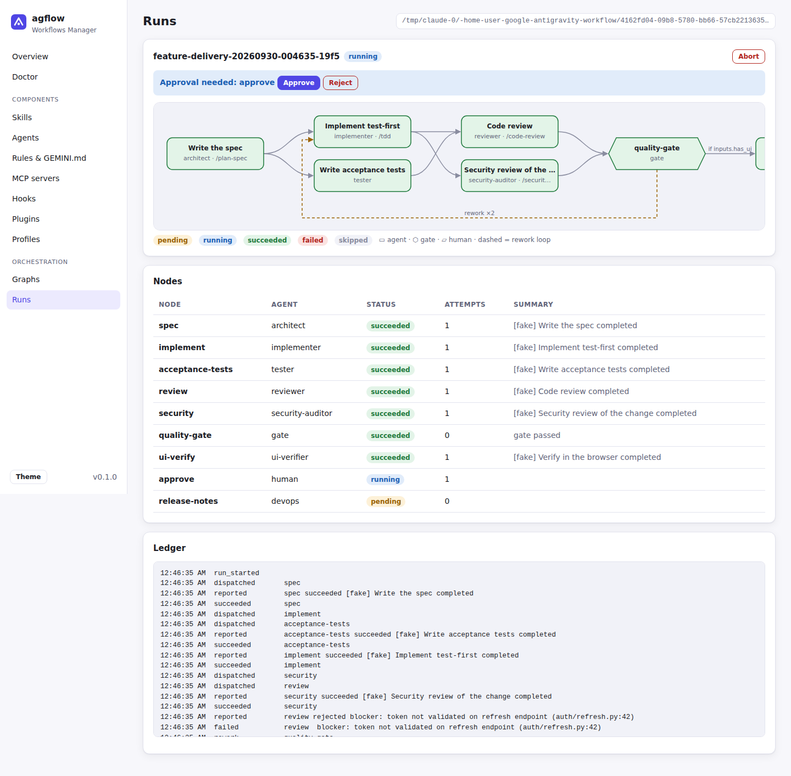
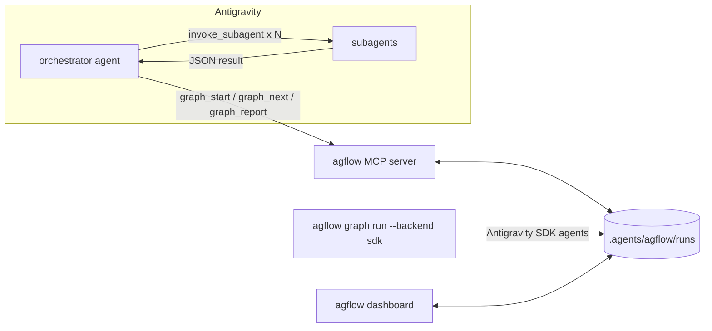
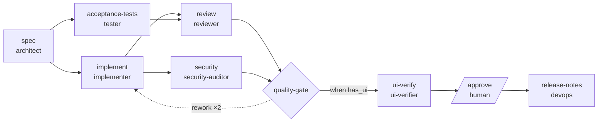
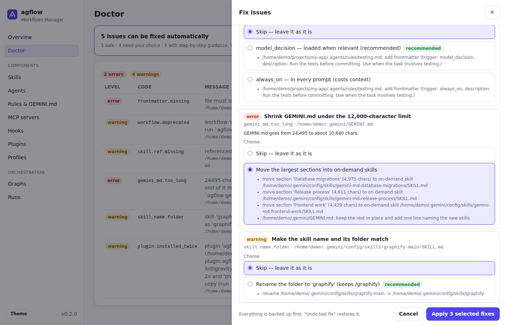
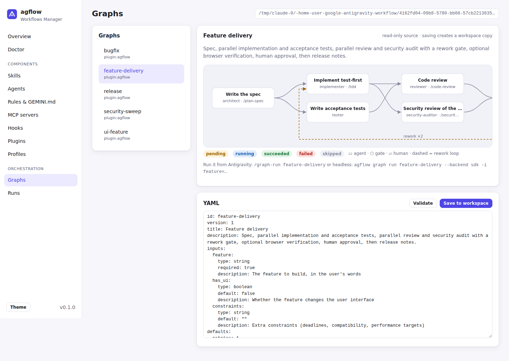

# agflow — Senior Workflows Manager for Google Antigravity

**agflow** makes Google Antigravity (and Gemini) work like a disciplined senior engineering team:

- an **advanced master prompt** (`GEMINI.md`) that turns the agent into an *Expert Senior Workflows Manager*
- **23 engineering skills** and **10 specialised subagents**, shipped as a native Antigravity plugin
- **graph orchestration**: multi-agent workflows as YAML graphs (parallel branches, quality gates with bounded rework loops, conditional steps, human approvals), driven **inside Antigravity** through an MCP server *or* **headless** through the Antigravity SDK
- a **manager app** (CLI + local dashboard) to install, validate, toggle and sync skills, agents, rules, MCP servers, hooks, plugins and profiles across global and workspace scopes
- **a manager panel inside Antigravity** (side pane): every workflow with the skills, agents, MCP servers and files it needs, how its runs went, and improvements waiting for your approval
- **grounding**: an evidence check on what agents report, an independent verifier, and a master prompt that says "label what you did not check"; every workflow **learns from its own runs**, and changes to it are only ever proposed
- **it keeps up with Antigravity**: a compatibility check against the installed Antigravity, and updates of agflow itself that are verified, backed up, reversible and applied only when you say so



---

## Contents

- [Quickstart](#quickstart)
- [What you get](#what-you-get)
- [How orchestration works](#how-orchestration-works)
- [Prompts](#prompts)
- [Manager CLI](#manager-cli)
- [Doctor & Fix](#doctor--fix)
- [Keeping agflow current](#keeping-agflow-current)
- [Fewer guesses: evidence, verification, lessons](#fewer-guesses-evidence-verification-lessons)
- [The manager inside Antigravity](#the-manager-inside-antigravity)
- [Dashboard](#dashboard)
- [Headless runs with the Antigravity SDK](#headless-runs-with-the-antigravity-sdk)
- [Safety hooks](#safety-hooks)
- [Where Antigravity looks for things](#where-antigravity-looks-for-things)
- [Writing your own graphs](#writing-your-own-graphs)
- [Development](#development)
- [Compatibility notes](#compatibility-notes)

## Quickstart

### Easiest: `easy-installer.bat` (Windows, Linux, macOS, WSL, BSD)

Download or clone this repository, then run one file. It installs everything it needs (the `uv`
package manager and, through it, Python), builds agflow from source, installs the `agflow` command and
the Antigravity plugin, and runs a health check.

| Platform | Command |
|---|---|
| Windows | double-click `easy-installer.bat`, or run `easy-installer.bat` in a terminal |
| Linux, macOS, WSL, BSD | `sh easy-installer.bat` |

| Option | Effect |
|---|---|
| `--yes` / `-y` | never ask (for scripts and CI) |
| `--test` | also run the test suite and validate the plugin before installing |
| `--profile NAME` | install only a plugin profile: `core`, `secure`, `frontend`, `devops`, `full` |
| `--no-plugin` | install only the `agflow` command |
| `--no-sdk` | skip the Antigravity SDK (only headless `--backend sdk` runs need it) |
| `--editable` | developer install: source changes apply without reinstalling |
| `--uninstall` | remove the plugin (restoring backed-up files) and the `agflow` command |

The same file works everywhere because it is both a Windows batch script and a POSIX shell script. Each
half only makes sure `uv` exists (it asks before downloading it from astral.sh) and then runs
[`scripts/easy_install.py`](scripts/easy_install.py), which does the identical steps on every OS.
Open a new terminal afterwards so `agflow` is on your PATH.

**How uv is bootstrapped.** If `uv` is missing, the installer does *not* pipe a download into a shell. It
fetches the installer of one specific uv release (the version and the SHA-256 of its installer scripts are pinned in
[`scripts/uv-pin.env`](scripts/uv-pin.env)) to a temporary file, verifies the checksum, and only then runs it; a
mismatch aborts with the expected and actual digests and runs nothing. To use another uv release (for example in
CI), set `AGFLOW_UV_VERSION` together with `AGFLOW_UV_INSTALLER_SHA256` (the SHA-256 of that release's
`uv-installer.sh` / `uv-installer.ps1`); a version override without a checksum is refused.

**Updating:** delete (or rename) the old project folder, extract the new zip to a fresh location, and run
the `easy-installer.bat` that sits directly next to `pyproject.toml`. Line `[1/7]` of the output shows the
version being installed (`ok agflow 0.4.0 …`); the installer stops if it finds a newer copy nested inside
the folder you ran it from, and verifies that the installed `agflow version` matches.

**Windows and running agflow:** Windows can't replace a program that is running, and Google Antigravity
keeps agflow's MCP server running while it is open. The installer detects agflow's own running processes
(MCP server, dashboard, hooks), lists them and offers to stop them (automatically with `--yes`), then asks
you to restart Antigravity at the end. If files stay locked (for example by an antivirus scan or an
Explorer window inside `%APPDATA%\uv\tools\agflow`), it tells you exactly what to close.

### Manual install

```bash
# 1. Install the manager (Python ≥ 3.10). Add [sdk] for headless runs.
uv tool install "agflow[sdk] @ git+https://github.com/MrKazino/AG-Flow"
#    or: pipx install "agflow[sdk] @ git+https://github.com/MrKazino/AG-Flow"

# 2. Install the plugin globally: master prompt, rules, skills, subagents, hooks, orchestrator MCP.
agflow install --dry-run      # preview every file it will touch
agflow install                # backs up anything it overwrites

# 3. Check the whole setup (all scopes).
agflow doctor

# 4. Restart Antigravity (or reload the window). For the agy CLI you can also run:
#    agy plugin install ~/.gemini/config/plugins/agflow
```

Then, in Antigravity, try:

```text
Run the agflow feature-delivery graph for this workspace. feature: "CSV export on the reports page", has_ui: true
```

Prefer a smaller footprint? Install a **profile** (`core`, `secure`, `frontend`, `devops`, `full`):

```bash
agflow install --profile frontend            # global
agflow init --profile core                   # scaffold .agents/ and install into the current workspace
```

Undo everything with `agflow uninstall` (your own `GEMINI.md` content is preserved).

## What you get

| Component | Where | Purpose |
|---|---|---|
| Master prompt | [`plugin/GEMINI.md`](plugin/GEMINI.md) | Operating system for the agent: task sizing, plan → execute → verify → report loop, a grounding protocol (sources, confidence labels, no invented names), routing table, orchestration protocol, engineering standards, failure policy, definition of done. 10.3k chars (the cap is 12k), merged into `~/.gemini/GEMINI.md` as a managed block. |
| Rules | [`plugin/rules/`](plugin/rules) | `operating-contract` and `security-baseline` (always on), `code-quality` and `orchestration` (model decision), `testing` and `frontend` (glob). |
| Skills (25) | [`plugin/skills/`](plugin/skills) | **Core:** plan-spec, tdd, debug-systematic, code-review, refactor-safely, docs-writer · **Grounding & learning:** verify-claims, deep-research, retrospective · **Security & quality:** security-audit, dependency-audit, perf-profile, coverage-gaps · **Frontend & browser:** ui-build-verify, a11y-audit, visual-regression · **DevOps & release:** ci-fix, containerize-deploy, release-notes, incident-triage · **Meta:** graph-run, graph-design, workflow-manager, workspace-setup, compat-sync |
| Subagents (10) | [`plugin/agents/`](plugin/agents) | `orchestrator` (main agent), architect, implementer, tester, reviewer, verifier, security-auditor, ui-verifier, devops, researcher. Each has scoped tools, a model tier and a strict JSON result contract. |
| Orchestrator MCP | `agflow mcp serve` | `graph_list/describe/validate/start/next/report/status/runs/resume/abort/lessons/overview` + `agflow://` resources. |
| Graphs (5) | [`plugin/graphs/`](plugin/graphs) | `feature-delivery`, `bugfix`, `security-sweep`, `ui-feature`, `release` |
| Hooks | [`plugin/hooks.json`](plugin/hooks.json) | Safety guard, run ledger, keep-going-while-work-is-ready (see [Safety hooks](#safety-hooks)). |
| Profiles | [`plugin/profiles.yaml`](plugin/profiles.yaml) | Named bundles of skills/agents/MCP servers. |
| Prompts | [`prompts/`](prompts) | Copy-paste prompts: kickoff, orchestrate, self-improve. |
| Manager | `agflow` CLI + `agflow dashboard` | Install, doctor, list, toggle, MCP registry, profiles, migration, Gemini CLI sync, graph tooling, headless runner, updates, Antigravity sync, workflow improvements. |
| Sidecars | [`plugin/sidecars/`](plugin/sidecars) | `manager` (the side-pane panel) and `maintenance` (a daily read-only check). Antigravity keeps them off until you switch them on. |

## How orchestration works

A graph is a DAG of **agent**, **gate** and **human** nodes. One pure state machine (`agflow.graph.engine`) drives it, and it is shared by both runners. Runs persist in `<workspace>/.agents/agflow/runs/<run_id>/` (`state.json`, `ledger.jsonl`, `report.md`), so they survive restarts and can be switched between runners. **Secrets:** inputs whose name looks like a credential (`api_key`, `*_TOKEN`, `password`, …) and well-known token shapes (`sk-…`, `ghp_…`, `AIza…`, `Bearer …`) are replaced by `***REDACTED***` in `ledger.jsonl`, `report.md` and `report.json`. `state.json` keeps the real values because the engine renders them into subagent prompts (`{{ inputs.api_key }}`); treat `.agents/agflow/runs/` as sensitive and keep it out of version control.



**Inside Antigravity**, the loop is:

1. `graph_start` (graph id, absolute workspace path, inputs)
2. `graph_next` returns **dispatch cards** for every ready node, up to `max_parallel`. Each card holds a fully composed `subagent_prompt`: the task, inputs, upstream results, rework feedback, acceptance criteria and the result contract.
3. The orchestrator calls `invoke_subagent` with `card.agent` and `card.subagent_prompt` for **all** cards in parallel.
4. Each subagent ends with `{"status": "succeeded|failed|rejected", "summary", "artifacts", "followups"}`, and the orchestrator reports it with `graph_report`.
5. The engine resolves the rest:
   - `failed` → retried until `retries` runs out
   - `rejected` → a downstream **gate** resets the upstream node (plus everything after it) with the reviewer's findings as feedback, bounded by `max_loops`
   - a falsy `when` → skipped
   - an upstream failure → blocked
   - expired lease → counted as a failed attempt
6. Human nodes pause for the user's approval.

The Stop hook nudges the agent to continue while claimable nodes remain, and gives up if no progress is made.

**One driver per run.** Whoever claims a node owns its report. Don't drive the same run from the MCP loop and from `agflow graph run` at the same time: the engine accepts the first report for a node and rejects a later one (`node 'x' is succeeded, not running`). The headless runner drops its late result, logs a `report_conflict` event (visible in the CLI output, the ledger and the dashboard) and carries on instead of abandoning the run.

The bundled **feature-delivery** graph:



## Prompts

| Prompt | Use it to |
|---|---|
| [`prompts/kickoff.md`](prompts/kickoff.md) | start any task with the senior-manager loop (sizing, plan, verification, walkthrough) |
| [`prompts/orchestrate.md`](prompts/orchestrate.md) | run a graph end to end, or design a new graph |
| [`prompts/self-improve.md`](prompts/self-improve.md) | audit and tune this workspace's agent setup (context budget, skills, MCP, profiles) |

## Manager CLI

```text
agflow doctor [--strict] [--path DIR]        validate everything (all scopes, or a plugin dir)
agflow doctor --source plugin:agflow         only one source (issues are grouped by source; --info lists notes)
agflow doctor --fix                          then repair: previews each fix, asks, applies, re-checks
agflow fix [--apply] [--all] [--only ID] [--option ID=OPTION] [--undo] [--history]
agflow gemini-md                             where GEMINI.md's size goes and what to trim (read-only)
agflow list [skill|agent|rule|mcp|...] [--all]
agflow status                                install status + active runs
agflow install [--workspace] [--profile P] [--no-hooks] [--no-gemini-md] [--link] [--dry-run] [--allow-duplicate]
agflow uninstall [--workspace]               restores every file it overwrote
agflow init [--profile P]                    scaffold .agents/ in a workspace and install
agflow skills|agents|rules list|new|enable|disable
agflow mcp list|catalog|add|remove|enable|disable|serve
agflow profile list|show|apply
agflow migrate [--dry-run]                   workflows → skills, .agent/ → .agents/, 1.x → 2.x paths (`agflow fix --undo` reverts)
agflow sync check|apply|forget               is AG-Flow still compatible with the installed Antigravity? (`check` is read-only; `apply` re-verifies a newer Antigravity and accepts it)
agflow sync gemini-cli [--project]           share skills + MCP servers with Gemini CLI (checks Gemini CLI's settings first; writes nothing if they are not as expected)
agflow update check|plan|apply|rollback|status|config   look for a newer AG-Flow on GitHub Releases; `apply` backs up, installs, keeps your edited plugin files, and undoes itself on any failure
agflow graph list|validate|render|compile|run|resume|approve|status|runs|abort
agflow improve lessons|propose|list|show|apply|reject|undo   what finished runs taught each workflow; changes are only ever proposed, and applied one at a time when you say so
agflow dashboard [--sidecar]                 local web UI (`--sidecar`: the AG-Flow Manager panel Antigravity opens in its side pane)
agflow workflows [GRAPH]                     each workflow with what it needs, whether that is installed, how its runs went and what awaits you
agflow maintenance run                       the daily upkeep (compatibility and update checks); read-only, installs nothing
agflow panel status|link                     is the AG-Flow Manager panel installed and switched on? the chat link that opens it
agflow version                               print the installed version
```

`doctor` reports **errors** only for problems that stop Antigravity from loading a file (bad frontmatter, invalid rule trigger, missing skill name/description, invalid JSON, unknown hook events, files over the 12,000-character cap). Style issues are warnings, and conventions Antigravity tolerates (for example underscore skill folders in Google's own plugins) are hidden info notes. Every issue is tagged with its source, so problems in other plugins or in your own files are never confused with agflow's.

Disabling a skill, agent or rule moves it to agflow's parking area outside Antigravity's discovery paths, so it's fully reversible. Every parked item also carries a `.agflow-disabled` marker (inside a folder, beside a file): if something moves a disabled item back into a folder Antigravity scans, `agflow doctor` warns (`disabled.marker_leak`) that it is active despite being disabled, and a parked item whose index entry was lost is still listed and can be enabled. `agflow doctor` also warns (`disabled.in_scan_scope`) if the parking area ever lies inside a scanned folder. MCP servers are disabled in place (`"disabled": true`). Writes are atomic and fsynced (a symlinked file is written through, and an existing file keeps its permissions), and each overwritten file is backed up under `~/.gemini/config/.agflow-backups/`.

`agflow install` is crash-safe: every backup is recorded in the install manifest *before* the thing it describes is changed, and the new plugin is built beside the old one and swapped in with two renames, so at every instant either the old or the new plugin is whole. If an install is interrupted (power loss, `kill`), `agflow doctor` reports `install.interrupted`; running `agflow install` (finish) or `agflow uninstall` (roll back) first puts a plugin that was moved aside back in place.

## Doctor & Fix

`agflow doctor` finds problems; **`agflow doctor --fix`**, **`agflow fix`** and the dashboard's
**Doctor → Fix issues…** button repair them. All three use the same engine:

- **Preview first.** Every fix lists exactly which files it will create, change, rename or remove.
- **Two tiers.** *Safe* fixes are mechanical (fill in a missing `name`, turn `"true"` into `true`, convert a
  deprecated workflow into a skill, reinstall a damaged agflow file) and are applied by `agflow fix --apply`.
  Fixes that *need your choice* rename, move or remove things, so nothing happens until you pick an option
  (`--all` takes each fix's recommended option; `--only ID --option ID=OPTION` picks one).
- **Reversible.** Everything a batch touches is copied to `~/.gemini/config/.agflow-backups/<time>-fix/`
  first; `agflow fix --undo` (or **Undo last fix** in the dashboard) restores it byte for byte and deletes
  what the batch created. `agflow fix --history` lists the last 20 batches.
- **Ownership.** Files of other plugins (for example Google's `science` plugin) are never edited, because
  their publisher's next update would overwrite the edit. Those issues get step-by-step guidance instead.
- **Verified.** After applying, doctor runs again and shows the counts before and after, plus any fix whose
  issue is still reported.

| Issue | Fix | Tier |
|---|---|---|
| agflow installed both globally and in the workspace (every skill/agent listed twice) | keep one copy: **global** (recommended) or **workspace**; the other is removed through agflow's own uninstall | choice |
| `GEMINI.md` over 12,000 characters | removes agflow's own block (agflow keeps working through its plugin rule), then moves the largest sections into on-demand skills `~/.gemini/config/skills/gemini-md-<topic>/` until it fits; blocks written by other tools (`<!-- tool:begin -->…`) are never moved | choice |
| skill name ≠ folder name | rename the folder, or set `name` to the folder | choice |
| rule/skill/agent without frontmatter | add valid frontmatter (rules: `model_decision` or `always_on`) | choice |
| invalid rule `trigger`, `glob` rule without `globs`, invalid agent `model` / `commandExecutionPolicy` | set a valid value (typos such as `always-on` are recognised) | choice |
| missing skill/agent description | derive "what + when" from the file's heading and first sentence | choice |
| missing `name`, text booleans in agent flags, `model_decision` rule without description | fill in / coerce | safe |
| deprecated workflow | convert it to a skill (the original is kept as `.bak`) | safe |
| error in an installed agflow file; hooks written in the layout Antigravity ignores (`hooks.inert`), without fail-open (`hooks.unguarded`), or that cannot start (`hooks.broken`) | reinstall that agflow copy, which rewrites the hooks and points them at the agflow that is running | safe |
| Antigravity 1.x leftovers (`.agent/`, `~/.gemini/antigravity/skills`) | migrate them to the 2.x locations | choice |
| missing referenced files, long skill bodies, secrets in MCP config, invalid JSON, true duplicates, other plugins' files | exact manual steps | manual |

```text
agflow fix                          preview: safe / needs your choice / manual
agflow fix --apply                  apply the safe fixes (asks first; --yes to skip the question)
agflow fix --apply --all            apply everything fixable with the recommended options
agflow fix --only 3f2a… --option 3f2a…=keep-global
agflow doctor --fix                 step by step: confirm the safe fixes, then choose per fix
agflow fix --undo                   revert the last batch
```

`agflow install` also refuses to create a second copy (global ↔ workspace) unless you pass
`--allow-duplicate`, and `agflow init` doesn't add a workspace copy when agflow is installed globally.



## Keeping agflow current

```text
agflow sync check                 is agflow still compatible with the installed Antigravity? (read-only)
agflow sync apply                 re-verify against a newer Antigravity (doctor and the hook probe first) and accept it
agflow update check|plan          is a newer agflow published, and what would updating do (or what blocks it)?
agflow update apply               back up, install, keep your edited plugin files, verify; undoes itself on any failure
agflow update rollback            restore the last backup
agflow maintenance run            the daily upkeep the scheduled sidecar runs (checks only)
```

**Antigravity changes between releases** (hook events and layouts, `plugin.json`, MCP config, sidecars). agflow does not
assume; it looks. `agflow sync check` reads the Antigravity version and the documentation that ships with it, extracts the
*names* those documents define (hook events and which are grouped, the decisions a hook may return, the fields of
`plugin.json`, `mcp_config.json` and `SKILL.md`, the sidecar fields, the documented size limits) and compares them with
[`compat_baseline.json`](src/agflow/data/compat_baseline.json): what this release was verified against, plus the names agflow's own hooks and manifests depend on. Only hashes and
short identifiers are kept, never the vendor's text. The answer is one of:

| Status | Meaning |
|---|---|
| `ok` | the vocabulary agflow was verified against is intact (documents may be reworded) |
| `drift` | Antigravity changed in a way agflow was not verified against, but nothing agflow depends on is gone: re-verify with `agflow sync apply` |
| `breaking` | something agflow depends on is no longer documented; the finding names the affected component. `sync apply` refuses to accept it; update agflow |
| `unknown` | Antigravity or its documents were not found: not an alarm |

`sync apply` accepts a newer Antigravity only after agflow's own doctor and live hook probe pass, and it writes nothing but a
small *accepted* baseline in `~/.gemini/config/agflow/` (`agflow sync forget` removes it).

**Updates come only from the GitHub Releases of `MrKazino/AG-Flow`** (the name `agflow` on PyPI is not this project, so
agflow never installs from there). An update is applied only when you run `agflow update apply` and confirm it:

1. the wheel is downloaded and must match `SHA256SUMS` and, when GitHub reports one, its own digest;
2. it is inspected without installing (it is agflow's, it is that version, nothing escapes its folders) and the new code is
   run on its own bundled plugin in a scratch folder (`agflow doctor --path`);
3. the installed package and every plugin file the installer touches are backed up;
4. it is installed into the Python environment agflow runs in (`uv pip`, else `pip`), then each existing plugin install is
   refreshed by the **new** code, and **your edited files are put back on top**: a file you changed stays yours; when the
   new version changed it too, the new copy is saved under `~/.gemini/config/agflow/incoming/` for you to merge;
5. the new version's doctor and hook probe must pass; if anything fails the backup is restored automatically, and
   `agflow update rollback` restores it later (also after an interrupted update).

A release can declare the oldest Antigravity it supports and a Python requirement (`release.json`); a plan that cannot
proceed says why. agflow never installs or updates Antigravity itself, and never uses a token it was not given
(`AGFLOW_GITHUB_TOKEN`). Checks are cached and rate-limited (`agflow update config`: channel `stable`/`pre`, interval,
background checks on/off) and never run in a hook. A development install (a source checkout) is not updated by this
command; use git. No release is published yet, so `agflow update check` says so until the first one exists
(`scripts/make_release.py` builds it and `.github/workflows/release.yml` is a draft that publishes a tag).

## Fewer guesses: evidence, verification, lessons

A model can report "succeeded" with a confident summary and files it never wrote. agflow makes that **visible and harder**;
it cannot make a model infallible, and does not claim to.

- **The evidence check.** When an agent node reports `succeeded`, the engine looks at the workspace first (it reads files and
  runs nothing): every declared `outputs` path must exist and not be empty, every reported artifact must exist, the node's
  `checks` must hold (a file contains or does not contain a literal string, has a minimum size) and the summary must say
  something checkable. A node's `evidence` mode decides what a failure means: `off`, `advisory` (the default: recorded as
  warnings) or `required` (the report is refused and the node goes back with feedback that names exactly what is missing).
  The bundled graphs use `required` for every node that declares outputs. Each dispatched task lists what will be checked.
- **The verifier.** `feature-delivery` and `security-sweep` include a step run by the read-only `verifier` agent
  (skill `verify-claims`): it re-runs the checks other agents claimed and writes a *claims ledger* (claim, how checked,
  result). In `security-sweep` it checks that every cited file and line exists before findings are triaged.
- **The master prompt** has a grounding protocol: a claim needs a source you opened or a command you ran; reports label
  what was *verified*, *inferred* or *unknown*; no invented path, flag, API or version; read the installed version's
  documentation instead of trusting memory (skill `deep-research`).
- **Every workflow learns, you decide.** When a run finishes agflow records, per workflow
  (`.agents/agflow/workflows/<id>/`), how it went and what went wrong: a step the evidence check sent back, a reviewer's
  rejection, a timeout. Redacted, bounded, deterministic; no model is involved. The next dispatch of an affected step carries
  the lessons ("a reviewer rejected earlier work at this step (2x): …").

```text
agflow improve lessons [GRAPH]      what earlier runs taught each workflow
agflow improve propose [GRAPH|--all]  write a proposal if the same problem recurred (>= 2 runs, last 90 days)
agflow improve show|list ...        the changes, the evidence for each, and the exact diff
agflow improve apply ID [--only c1]   apply it (asks first; backed up; reversible)
agflow improve reject ID | undo GRAPH
```

  Proposals come from fixed rules (a step that ran out of time gets a longer limit, one that failed gets another retry, a
  check that let missing output through becomes `required`, a finding reviewers keep raising becomes an acceptance
  criterion). **Nothing is applied automatically**, and applying one writes a *workspace copy* of a bundled workflow
  (the plugin's file is never edited; the copy stops following agflow updates until you remove it with `improve undo`).
  A change you reject is not proposed again for 30 days. `agflow workflows` and `graph_overview` show what is waiting.

## The manager inside Antigravity

Antigravity's Settings screen is not an extension point. The supported ways to add UI are a **plugin sidecar** (a panel in
the side pane) and the plugin's own page under Customizations, so that is what agflow ships:

| Sidecar | What it is |
|---|---|
| `agflow/manager` | **AG-Flow Manager**: the dashboard as a side-pane panel (`agflow dashboard --sidecar`) |
| `agflow/maintenance` | a scheduled sidecar that runs `agflow maintenance run` once a day (checks only; installs nothing, starts no conversation) |

Sidecars are **off until you switch them on**, and agflow never does it for you: `agflow panel status` says where each one
stands and prints the steps (the Customizations page, or an `enabled: true` entry under `sidecars` in
`~/.gemini/config/config.json`). When the panel is on, a chat link opens it: `[AG-Flow Manager](sidecar://agflow/manager/)`
(`agflow panel link`). The installer points each sidecar at this machine's agflow with an absolute path.

The panel starts on the workspace that most recently had a run and lets you switch project (Antigravity does not tell a
sidecar which project is open). It adds two pages to the dashboard: **Workflows** (what each workflow needs, with where each
skill, agent and MCP server was found and which are missing or disabled; its steps and files; remembered runs and success
rate; lessons; proposals with the diff and apply / decline / undo) and **Sync & updates** (the compatibility check with
*Check now* and *Verify and accept*, the update check and plan, the state of the sidecars). A chip in the top bar shows a
note when Antigravity changed or an update is available. `agflow doctor` shows the same notes from the cached daily check.

The panel follows the handshake of Antigravity's own sidecar runtime (port and token from the environment, the token also
accepted in the pane's address and then removed from it); that is not a documented API and has been verified here
against the runtime of a sidecar that ships with Antigravity and in a browser, **not inside a live Antigravity window**.

## Dashboard

`agflow dashboard` serves a local UI on `127.0.0.1` behind a random token (printed in the URL), and rejects requests with a foreign `Host` header. It has no third-party JavaScript and works offline.

The token is only ever accepted in the `X-Agflow-Token` request header (the page keeps it in `sessionStorage`; the `#token=` in the printed URL is a fragment, which browsers never send to the server). `EventSource` cannot set headers, so the live run view first exchanges the token for a **one-time stream ticket** (`POST /api/stream-ticket`, valid ~30 s, single use, bound to one run, accepted only by that run's `/stream`) and opens the stream with `?ticket=`; a dropped connection simply asks for a new ticket. A token in a query string is rejected on every route, so it can never end up in browser history or proxy logs.

It also opens inside Antigravity as the panel described above (`agflow dashboard --sidecar`). It covers: overview and health, **workflows** and **sync & updates**, doctor with **Fix issues…** (preview, choose, apply, undo) and a migration preview, skills/agents/rules with toggles and file preview, a **GEMINI.md editor with a 12k-character meter**, MCP servers (catalog add, env checks, toggle, remove), hooks, plugins, profiles (apply), a **graph editor** (live validation and SVG graph view, saved to the workspace), and **runs** (live over SSE, approve/reject human nodes, abort, ledger).



## Headless runs with the Antigravity SDK

```bash
export GEMINI_API_KEY=...                       # or Vertex: GOOGLE_GENAI_USE_VERTEXAI=True + project/location
export AGFLOW_MODEL_PRO=<model id>              # optional: model for `model: pro` agents (SDK default otherwise)
export AGFLOW_MODEL_FLASH=<model id>            # optional: model for `model: flash` agents

agflow graph run bugfix -i bug="Crash on empty CSV upload"            # exit 0 ok · 1 failed · 3 waiting on a human
agflow graph approve <run_id> <node> [--reject] && agflow graph resume <run_id>
agflow graph run feature-delivery -i feature="…" --backend fake --approve-human   # dry run, no model calls
```

Each node runs as a fresh `google.antigravity.Agent`, configured from the node's custom-agent file:

- the agent body becomes the system instructions
- the agent's `tools` map to SDK `BuiltinTools`
- `commandExecutionPolicy: off` denies `run_command`
- file tools are restricted to the workspace
- the agflow guard denies destructive commands; headless runs also deny anything the guard would ask about, unless you pass `--allow-risky`
- results use structured output (`response_schema`)

## Safety hooks

| Event | What it does |
|---|---|
| PreToolUse | **deny**: `rm -rf /` or `~`, `mkfs`, raw disk writes, fork bombs. **ask**: force-push, `git reset --hard`, `curl … \| sh`, `rm -r` outside the workspace, destructive SQL, `terraform destroy`, `kubectl delete`, publishing, `sudo`, reading `.env`/keys/credentials. It never returns "allow", so your own permission settings stay in charge. |
| PostToolUse | Appends a compact entry to the ledger of each active run, for commands, edits and subagent calls (not for reads, so a plain `view_file` does not start a process). |
| Stop | Returns `continue` while an active run has claimable nodes and is progressing (capped). It never pushes the agent on after an error or a limit, and it ignores a run that nobody has touched for 24 hours (a new conversation is not dragged back into it). |

`agflow install` writes `hooks.json` in the layout Antigravity documents: a named hook (`agflow`) whose tool events hold `{matcher, hooks: [...]}` groups and whose `Stop` event holds plain handlers, each with a 10-second timeout. Earlier agflow releases wrote a different layout that Antigravity reads as a hook named `hooks` and, for the two tool events, ignores — so the guard and the run ledger never ran in a real session, and only the `Stop` hook did. `agflow doctor` reports that file as `hooks.inert`, and `agflow fix` rewrites it.

Hooks take a fast path that skips the CLI start-up, and their cost does not depend on how many runs a workspace holds: the active runs are found through a small self-healing index (`.agents/agflow/runs/.index.json`) instead of by reading every run, and a session with no running run answers from that index without loading the run store, pydantic or a YAML parser. Measured with `scripts/bench.py` (1 running run among 1, 50 and 500 finished ones), the PostToolUse handler takes about 3–5 ms on Windows 11 and 0.3–1 ms on Linux (WSL2) at every size. What each hook call still pays is process start-up and imports, a constant of roughly 0.05 s on Linux and 0.2 s on Windows on the development machine used for those numbers (`python -m agflow hook …` with no running run; a bare `python -c pass` took 0.013 s and 0.1 s there); yours will differ. Tune them per workspace in `.agents/agflow/guard.yaml` (`deny:`, `ask:` and `allow:` regex lists), turn the guard off with `AGFLOW_GUARD=off`, or install without hooks using `agflow install --no-hooks`. Set `AGFLOW_HOOK_DEBUG=1` to log raw payloads to `~/.gemini/config/agflow/hook-debug.jsonl`.

**A hook never breaks the agent, and it never fails silently either.** If Antigravity sends a payload agflow cannot read (a changed layout, a renamed `CommandLine`, invalid JSON) the hook still answers `{}` so the agent keeps working — but the guard could not check that call, so agflow records it: a line in `hook-debug.jsonl` (key names only, never values), a counter in `~/.gemini/config/agflow/hook-health.jsonl`, a `guard_unavailable` event in the ledger of each active run, a red banner on the dashboard overview, and an `agflow doctor` warning (`hooks.guard_blind`) that clears itself seven days after the last occurrence. A crashing handler is counted the same way. To teach agflow a renamed key without waiting for a release, add it under `hook_payload_keys` in `~/.gemini/config/agflow/vocab.json` (see [Compatibility notes](#compatibility-notes)).

### When the agent reports an error

Antigravity ends a turn with *"Agent execution terminated due to error"* or *"There was a network issue connecting to the server, please try again"* for reasons that are not all agflow's. A failing hook is the one agflow can cause, so hooks are built not to:

- **Every installed hook command fails open.** If the agflow executable is missing, was replaced by an upgrade, or its tool environment was deleted (the classic `ModuleNotFoundError: No module named 'agflow'` from a stale `agflow.exe`), the command prints `{}` — "no opinion" for every event — with exit code 0 and a note on stderr, instead of the exit code 1 that Antigravity reports as *"Stop hook failed"* or *"pre-tool hooks failed"*. Inside agflow nothing can escape either: any exception, an unreadable input, or a handler that runs longer than 8 seconds still ends in `{}` with exit code 0.
- **Nothing fails silently.** Fail-open hides the breakage from the agent, so `agflow doctor` (and `agflow fix`) *runs* each hook command of your installed agflow plugin the way Antigravity does and reports `hooks.broken` as an error when one cannot start, with the last line of its error. It runs only the global copy under your own `~/.gemini` (never a file from a workspace, which may belong to a repository you just cloned), only a line in exactly the form `agflow install` writes (one agflow call and the fixed fail-open tail, nothing a shell could treat as a second command), and in an empty scratch folder; the dashboard never runs anything. `agflow fix` reinstalls that copy and points the hooks at the agflow that is running; if agflow was installed with `uv tool`, `uv tool install --force --reinstall <agflow checkout or package>` repairs the broken environment itself. Hooks that predate fail-open are reported as `hooks.unguarded`.
- **A stop caused by an error is final.** The Stop hook does not ask the agent to continue after the documented termination reasons for errors, exhausted steps or cancellation, so an outage is not met with a second round of the same failure.
- **The "network issue" message is not from a hook.** It means Antigravity could not reach Google's model service; agflow's hooks, MCP server and dashboard make no outgoing network requests (the dashboard listens on 127.0.0.1 unless you change `--host`). Retry, and check a VPN, proxy or firewall rule if it persists. If it hit while a graph run was in flight, the orchestrator calls `graph_resume`, which returns the interrupted nodes to *ready* without spending an attempt.

To tell the two kinds apart: a hook failure is logged by the Antigravity CLI as `failed to call custom stop hook …` (or `pre-tool hooks failed`) in `~/.gemini/antigravity-cli/log/cli-*.log`, and `agflow doctor` reports `hooks.broken`; a network failure is neither.

## Where Antigravity looks for things

agflow targets the Antigravity 2.x layout. All paths live in one module, [`src/agflow/paths.py`](src/agflow/paths.py).

| Component | Workspace | Global |
|---|---|---|
| Rules | `.agents/rules/*.md` (`trigger: always_on \| model_decision \| glob \| manual`) | `~/.gemini/GEMINI.md` (12,000-char cap) |
| Skills | `.agents/skills/<name>/SKILL.md` | `~/.gemini/config/skills/` |
| Custom agents | `.agents/agents/<name>.md` | `~/.gemini/config/agents/` |
| Plugins | `.agents/plugins/<name>/plugin.json` | `~/.gemini/config/plugins/` |
| Hooks | `.agents/hooks.json` | `~/.gemini/config/hooks.json` |
| MCP servers | `.agents/mcp_config.json` | `~/.gemini/config/mcp_config.json` |
| Workflows (retired 2026-11-01) | `.agents/workflows/` | `~/.gemini/config/global_workflows/` |

Legacy 1.x locations (`.agent/`, `~/.gemini/antigravity/`) are detected by `agflow doctor` and migrated by `agflow migrate`.

## Writing your own graphs

Use the `graph-design` skill, or write YAML by hand. The full schema is in [`plugin/skills/graph-design/references/schema.md`](plugin/skills/graph-design/references/schema.md).

```yaml
id: api-change
inputs: {change: {type: string, required: true}}
defaults: {retries: 1, max_parallel: 3}
nodes:
  - {id: spec, agent: architect, skill: plan-spec, prompt: "Spec: {{ inputs.change }}"}
  - {id: build, agent: implementer, skill: tdd, depends_on: [spec]}
  - {id: review, agent: reviewer, skill: code-review, depends_on: [build]}
  - {id: gate, type: gate, depends_on: [review], on_fail: {goto: build, max_loops: 2}}
  - {id: ship, type: human, prompt: "Merge it?", depends_on: [gate]}
```

Name inputs like node ids (lowercase, starting with a letter; `change`, `has_ui`): `agflow doctor` warns about any other name (`graph.input.name`) and agflow 0.5.0 will reject it. Prefer `_` to `-`, because `{{ inputs.bug-id }}` subtracts and only `inputs['bug-id']` reads that input.

Save it to `.agents/agflow/graphs/api-change.yaml`, then:

- `agflow graph validate` checks it
- `agflow graph render` prints Mermaid
- `agflow graph compile api-change` makes `/api-change` a slash-invocable skill

## Development

```bash
uv sync --all-extras
uv run pytest                                   # engine, MCP (in-process + stdio), installer, hooks, CLI, dashboard, SDK config
uv run pytest --cov=agflow                      # the same with a coverage report; CI fails below 88 % (Ubuntu, Python 3.12)
uv run pytest tests/test_sdk_contract.py --update-sdk-snapshot   # after reviewing a new Antigravity SDK release (a nightly job checks the newest one)
uv run ruff check src tests
uv run agflow doctor --path plugin --strict     # the bundled plugin must stay clean
uv run agflow graph validate plugin/graphs/*.yaml
uv run python scripts/bench.py                  # hook latency vs. number of runs, doctor runtime on a big plugin, start-up times
uv run python scripts/smoke_release.py          # real wheels, a throwaway venv and a sandboxed HOME: update, rollback, a broken release refused
uv run python scripts/make_release.py           # wheel, sdist, SHA256SUMS and release.json in dist/release (builds and checks; publishes nothing)
```

Start-up, measured with `scripts/bench.py --only startup` (Windows 11, Python 3.14, median of 5 fresh interpreters; yours will differ):

| | 0.3.0 | 0.4.0 |
|---|---|---|
| `agflow version` | 560 ms | 94 ms |
| `agflow doctor` (includes running the three installed hooks once) | 3167 ms | 1746 ms |
| `import agflow.cli` | 510 ms | 410 ms |
| one idle PreToolUse hook | 193 ms | 179 ms |

`import agflow.mcp_server` takes about 1.5 s here, almost all of it the `mcp` package itself; agflow loads its own manager modules only when their tool is called.

Layout: `plugin/` holds the Antigravity plugin, shipped inside the wheel as `agflow/_plugin`. `src/agflow/` holds the manager, the engine, the MCP server, the runner and the dashboard. `prompts/` has the copy-paste prompts, and `tests/` the test suite.

## Compatibility notes

- These were verified against **Antigravity 2.x documentation as of September 2026**, MCP Python SDK 2.x, and `google-antigravity` SDK 0.1.20:
  - the paths, rule triggers, agent frontmatter and hook event names above
  - the hook stdin payload follows Antigravity's own hook documentation (it ships inside the product, in `builtin/skills/agy-customizations/docs/hooks.md`: camelCase, the tool call under `toolCall`, `workspacePaths`); agflow also still accepts the older flat variants it used to guess. The contract tests in `tests/fixtures/hook_payloads/` label each sample's provenance (`vendor-doc`, `captured`, `synthetic`); no payload recorded from a live session is included yet.
- The `hooks.json` layout agflow writes (named hook → event → `{matcher, hooks}` groups for the tool events, plain handlers for the others) follows `hooks.md` in the same Antigravity folder. It was checked against the Antigravity CLI 1.3.3 log, which counts the named hooks it loads and shows the hook that failed by name. The CLI's own change log says an empty `decision` from a pre-tool hook is handled since 1.0.16; before that it was an error, so with an older CLI install with `--no-hooks`.
- Loading the plugin in a live Antigravity app and making SDK model calls can't be exercised in CI. Run `agflow doctor` after installing, and try the fake backend first.
- Workflows are retired on **2026-11-01**. agflow ships only skills, and `agflow migrate` converts your existing workflows.
- **The Antigravity vocabulary is data, not code.** Agent tool names, model tiers, execution policies, rule triggers,
  hook events, hook-payload key variants and the workflow retirement date live in one versioned table
  ([`src/agflow/data/platform_vocab.json`](src/agflow/data/platform_vocab.json), `vocab_version` is shown in doctor
  messages). Everything else derives from it. If Antigravity renames or adds one, you do not need a new release:
  put the change in `~/.gemini/config/agflow/vocab.json` (or `.agents/agflow/vocab.json` for one workspace), for
  example `{"vocab_version": "mine", "agent_tools": {"add": ["new_tool"]}, "sdk_tool_map": {"set": {"new_tool":
  "view_file"}}}`. An invalid override is ignored as a whole and reported by `agflow doctor`
  (`vocab.override.invalid`); an applied one is listed as `vocab.override`. A tool name the table has never
  heard of is reported as *unknown to this agflow version* (INFO in doctor, a warning when a headless agent starts).

## License

Apache-2.0
