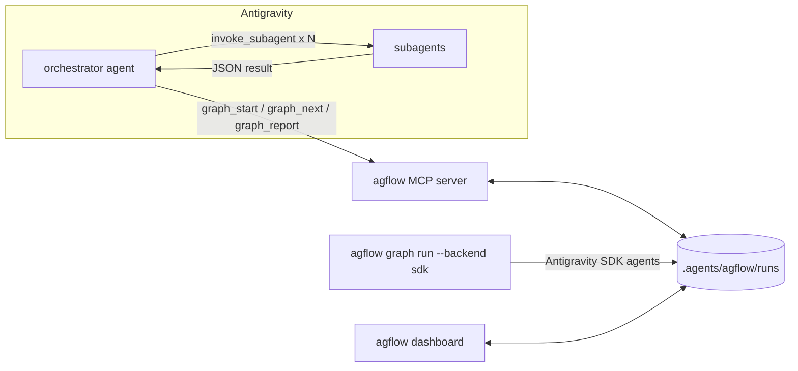
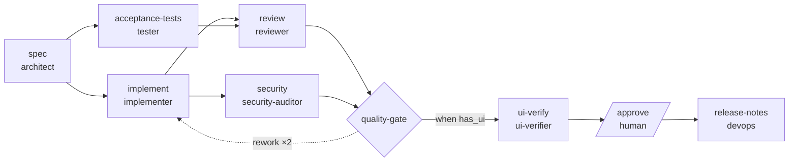

# agflow — Senior Workflows Manager for Google Antigravity

**agflow** makes Google Antigravity (and Gemini) work like a disciplined senior engineering team:

- an **advanced master prompt** (`GEMINI.md`) that turns the agent into an *Expert Senior Workflows Manager*
- **20 engineering skills** and **9 specialised subagents**, shipped as a native Antigravity plugin
- **graph orchestration**: multi-agent workflows as YAML graphs (parallel branches, quality gates with bounded rework loops, conditional steps, human approvals), driven **inside Antigravity** through an MCP server *or* **headless** through the Antigravity SDK
- a **manager app** (CLI + local dashboard) to install, validate, toggle and sync skills, agents, rules, MCP servers, hooks, plugins and profiles across global and workspace scopes


---

## Contents

- [Quickstart](#quickstart)
- [What you get](#what-you-get)
- [How orchestration works](#how-orchestration-works)
- [Prompts](#prompts)
- [Manager CLI](#manager-cli)
- [Doctor & Fix](#doctor--fix)
- [Dashboard](#dashboard)
- [Headless runs with the Antigravity SDK](#headless-runs-with-the-antigravity-sdk)
- [Safety hooks](#safety-hooks)
- [Where Antigravity looks for things](#where-antigravity-looks-for-things)
- [Writing your own graphs](#writing-your-own-graphs)
- [Development](#development)
- [Compatibility notes](#compatibility-notes)

## Quickstart

### Easiest: `easy-installer.bat` (Windows, Linux, macOS, WSL, BSD)

Download or clone this repository, then run one file. It installs everything it needs (the `uv`
package manager and, through it, Python), builds agflow from source, installs the `agflow` command and
the Antigravity plugin, and runs a health check.

| Platform | Command |
|---|---|
| Windows | double-click `easy-installer.bat`, or run `easy-installer.bat` in a terminal |
| Linux, macOS, WSL, BSD | `sh easy-installer.bat` |

| Option | Effect |
|---|---|
| `--yes` / `-y` | never ask (for scripts and CI) |
| `--test` | also run the test suite and validate the plugin before installing |
| `--profile NAME` | install only a plugin profile: `core`, `secure`, `frontend`, `devops`, `full` |
| `--no-plugin` | install only the `agflow` command |
| `--no-sdk` | skip the Antigravity SDK (only headless `--backend sdk` runs need it) |
| `--editable` | developer install: source changes apply without reinstalling |
| `--uninstall` | remove the plugin (restoring backed-up files) and the `agflow` command |

The same file works everywhere because it is both a Windows batch script and a POSIX shell script. Each
half only makes sure `uv` exists (it asks before downloading it from astral.sh) and then runs
[`scripts/easy_install.py`](scripts/easy_install.py), which does the identical steps on every OS.
Open a new terminal afterwards so `agflow` is on your PATH.

**How uv is bootstrapped.** If `uv` is missing, the installer does *not* pipe a download into a shell. It
fetches the installer of one specific uv release (the version and the SHA-256 of its installer scripts are pinned in
[`scripts/uv-pin.env`](scripts/uv-pin.env)) to a temporary file, verifies the checksum, and only then runs it; a
mismatch aborts with the expected and actual digests and runs nothing. To use another uv release (for example in
CI), set `AGFLOW_UV_VERSION` together with `AGFLOW_UV_INSTALLER_SHA256` (the SHA-256 of that release's
`uv-installer.sh` / `uv-installer.ps1`); a version override without a checksum is refused.

**Updating:** delete (or rename) the old project folder, extract the new zip to a fresh location, and run
the `easy-installer.bat` that sits directly next to `pyproject.toml`. Line `[1/7]` of the output shows the
version being installed (`ok agflow 0.2.0 …`); the installer stops if it finds a newer copy nested inside
the folder you ran it from, and verifies that the installed `agflow version` matches.

**Windows and running agflow:** Windows can't replace a program that is running, and Google Antigravity
keeps agflow's MCP server running while it is open. The installer detects agflow's own running processes
(MCP server, dashboard, hooks), lists them and offers to stop them (automatically with `--yes`), then asks
you to restart Antigravity at the end. If files stay locked (for example by an antivirus scan or an
Explorer window inside `%APPDATA%\uv\tools\agflow`), it tells you exactly what to close.

### Manual install

```bash
# 1. Install the manager (Python ≥ 3.10). Add [sdk] for headless runs.
uv tool install "agflow[sdk] @ git+https://github.com/MrKazino/google-antigravity-workflow"
#    or: pipx install "agflow[sdk] @ git+https://github.com/MrKazino/google-antigravity-workflow"

# 2. Install the plugin globally: master prompt, rules, skills, subagents, hooks, orchestrator MCP.
agflow install --dry-run      # preview every file it will touch
agflow install                # backs up anything it overwrites

# 3. Check the whole setup (all scopes).
agflow doctor

# 4. Restart Antigravity (or reload the window). For the agy CLI you can also run:
#    agy plugin install ~/.gemini/config/plugins/agflow
```

Then, in Antigravity, try:

```text
Run the agflow feature-delivery graph for this workspace. feature: "CSV export on the reports page", has_ui: true
```

Prefer a smaller footprint? Install a **profile** (`core`, `secure`, `frontend`, `devops`, `full`):

```bash
agflow install --profile frontend            # global
agflow init --profile core                   # scaffold .agents/ and install into the current workspace
```

Undo everything with `agflow uninstall` (your own `GEMINI.md` content is preserved).

## What you get

| Component | Where | Purpose |
|---|---|---|
| Master prompt | [`plugin/GEMINI.md`](plugin/GEMINI.md) | Operating system for the agent: task sizing, plan → execute → verify → report loop, routing table, orchestration protocol, engineering standards, failure policy, definition of done. 7.5k chars (the cap is 12k), merged into `~/.gemini/GEMINI.md` as a managed block. |
| Rules | [`plugin/rules/`](plugin/rules) | `operating-contract` and `security-baseline` (always on), `code-quality` and `orchestration` (model decision), `testing` and `frontend` (glob). |
| Skills (20) | [`plugin/skills/`](plugin/skills) | **Core:** plan-spec, tdd, debug-systematic, code-review, refactor-safely, docs-writer · **Security & quality:** security-audit, dependency-audit, perf-profile, coverage-gaps · **Frontend & browser:** ui-build-verify, a11y-audit, visual-regression · **DevOps & release:** ci-fix, containerize-deploy, release-notes, incident-triage · **Meta:** graph-run, graph-design, workspace-setup |
| Subagents (9) | [`plugin/agents/`](plugin/agents) | `orchestrator` (main agent), architect, implementer, tester, reviewer, security-auditor, ui-verifier, devops, researcher. Each has scoped tools, a model tier and a strict JSON result contract. |
| Orchestrator MCP | `agflow mcp serve` | `graph_list/describe/validate/start/next/report/status/runs/resume/abort` + `agflow://` resources. |
| Graphs (5) | [`plugin/graphs/`](plugin/graphs) | `feature-delivery`, `bugfix`, `security-sweep`, `ui-feature`, `release` |
| Hooks | [`plugin/hooks.json`](plugin/hooks.json) | Safety guard, run ledger, keep-going-while-work-is-ready (see [Safety hooks](#safety-hooks)). |
| Profiles | [`plugin/profiles.yaml`](plugin/profiles.yaml) | Named bundles of skills/agents/MCP servers. |
| Prompts | [`prompts/`](prompts) | Copy-paste prompts: kickoff, orchestrate, self-improve. |
| Manager | `agflow` CLI + `agflow dashboard` | Install, doctor, list, toggle, MCP registry, profiles, migration, Gemini CLI sync, graph tooling, headless runner. |

## How orchestration works

A graph is a DAG of **agent**, **gate** and **human** nodes. One pure state machine (`agflow.graph.engine`) drives it, and it is shared by both runners. Runs persist in `<workspace>/.agents/agflow/runs/<run_id>/` (`state.json`, `ledger.jsonl`, `report.md`), so they survive restarts and can be switched between runners. **Secrets:** inputs whose name looks like a credential (`api_key`, `*_TOKEN`, `password`, …) and well-known token shapes (`sk-…`, `ghp_…`, `AIza…`, `Bearer …`) are replaced by `***REDACTED***` in `ledger.jsonl`, `report.md` and `report.json`. `state.json` keeps the real values because the engine renders them into subagent prompts (`{{ inputs.api_key }}`); treat `.agents/agflow/runs/` as sensitive and keep it out of version control.



**Inside Antigravity**, the loop is:

1. `graph_start(graph, workspace, inputs)`
2. `graph_next(run_id)` returns **dispatch cards** for every ready node, up to `max_parallel`. Each card holds a fully composed `subagent_prompt`: the task, inputs, upstream results, rework feedback, acceptance criteria and the result contract.
3. The orchestrator calls `invoke_subagent(card.agent, card.subagent_prompt)` for **all** cards in parallel.
4. Each subagent ends with `{"status": "succeeded|failed|rejected", "summary", "artifacts", "followups"}`, and the orchestrator reports it with `graph_report`.
5. The engine resolves the rest:
   - `failed` → retried until `retries` runs out
   - `rejected` → a downstream **gate** resets the upstream node (plus everything after it) with the reviewer's findings as feedback, bounded by `max_loops`
   - a falsy `when` → skipped
   - an upstream failure → blocked
   - expired lease → counted as a failed attempt
6. Human nodes pause for the user's approval.

The Stop hook nudges the agent to continue while claimable nodes remain, and gives up if no progress is made.

**One driver per run.** Whoever claims a node owns its report. Don't drive the same run from the MCP loop and from `agflow graph run` at the same time: the engine accepts the first report for a node and rejects a later one (`node 'x' is succeeded, not running`). The headless runner drops its late result, logs a `report_conflict` event (visible in the CLI output, the ledger and the dashboard) and carries on instead of abandoning the run.

The bundled **feature-delivery** graph:



## Prompts

| Prompt | Use it to |
|---|---|
| [`prompts/kickoff.md`](prompts/kickoff.md) | start any task with the senior-manager loop (sizing, plan, verification, walkthrough) |
| [`prompts/orchestrate.md`](prompts/orchestrate.md) | run a graph end to end, or design a new graph |
| [`prompts/self-improve.md`](prompts/self-improve.md) | audit and tune this workspace's agent setup (context budget, skills, MCP, profiles) |

## Manager CLI

```text
agflow doctor [--strict] [--path DIR]        validate everything (all scopes, or a plugin dir)
agflow doctor --source plugin:agflow         only one source (issues are grouped by source; --info lists notes)
agflow doctor --fix                          then repair: previews each fix, asks, applies, re-checks
agflow fix [--apply] [--all] [--only ID] [--option ID=OPTION] [--undo] [--history]
agflow gemini-md                             where GEMINI.md's size goes and what to trim (read-only)
agflow list [skill|agent|rule|mcp|...] [--all]
agflow status                                install status + active runs
agflow install [--workspace] [--profile P] [--no-hooks] [--no-gemini-md] [--link] [--dry-run] [--allow-duplicate]
agflow uninstall [--workspace]               restores every file it overwrote
agflow init [--profile P]                    scaffold .agents/ in a workspace and install
agflow skills|agents|rules list|new|enable|disable
agflow mcp list|catalog|add|remove|enable|disable|serve
agflow profile list|show|apply
agflow migrate [--dry-run]                   workflows → skills, .agent/ → .agents/, 1.x → 2.x paths
agflow sync gemini-cli [--project]           share skills + MCP servers with Gemini CLI
agflow graph list|validate|render|compile|run|resume|approve|status|runs|abort
agflow dashboard                             local web UI
```

`doctor` reports **errors** only for problems that stop Antigravity from loading a file (bad frontmatter, invalid rule trigger, missing skill name/description, invalid JSON, unknown hook events, files over the 12,000-character cap). Style issues are warnings, and conventions Antigravity tolerates (for example underscore skill folders in Google's own plugins) are hidden info notes. Every issue is tagged with its source, so problems in other plugins or in your own files are never confused with agflow's.

Disabling a skill, agent or rule moves it to agflow's parking area outside Antigravity's discovery paths, so it's fully reversible. MCP servers are disabled in place (`"disabled": true`). Writes are atomic and fsynced (a symlinked file is written through, and an existing file keeps its permissions), and each overwritten file is backed up under `~/.gemini/config/.agflow-backups/`.

`agflow install` is crash-safe: every backup is recorded in the install manifest *before* the thing it describes is changed, and the new plugin is built beside the old one and swapped in with two renames, so at every instant either the old or the new plugin is whole. If an install is interrupted (power loss, `kill`), `agflow doctor` reports `install.interrupted`; running `agflow install` (finish) or `agflow uninstall` (roll back) first puts a plugin that was moved aside back in place.

## Doctor & Fix

`agflow doctor` finds problems; **`agflow doctor --fix`**, **`agflow fix`** and the dashboard's
**Doctor → Fix issues…** button repair them. All three use the same engine:

- **Preview first.** Every fix lists exactly which files it will create, change, rename or remove.
- **Two tiers.** *Safe* fixes are mechanical (fill in a missing `name`, turn `"true"` into `true`, convert a
  deprecated workflow into a skill, reinstall a damaged agflow file) and are applied by `agflow fix --apply`.
  Fixes that *need your choice* rename, move or remove things, so nothing happens until you pick an option
  (`--all` takes each fix's recommended option; `--only ID --option ID=OPTION` picks one).
- **Reversible.** Everything a batch touches is copied to `~/.gemini/config/.agflow-backups/<time>-fix/`
  first; `agflow fix --undo` (or **Undo last fix** in the dashboard) restores it byte for byte and deletes
  what the batch created. `agflow fix --history` lists the last 20 batches.
- **Ownership.** Files of other plugins (for example Google's `science` plugin) are never edited, because
  their publisher's next update would overwrite the edit. Those issues get step-by-step guidance instead.
- **Verified.** After applying, doctor runs again and shows the counts before and after, plus any fix whose
  issue is still reported.

| Issue | Fix | Tier |
|---|---|---|
| agflow installed both globally and in the workspace (every skill/agent listed twice) | keep one copy: **global** (recommended) or **workspace**; the other is removed through agflow's own uninstall | choice |
| `GEMINI.md` over 12,000 characters | removes agflow's own block (agflow keeps working through its plugin rule), then moves the largest sections into on-demand skills `~/.gemini/config/skills/gemini-md-<topic>/` until it fits; blocks written by other tools (`<!-- tool:begin -->…`) are never moved | choice |
| skill name ≠ folder name | rename the folder, or set `name` to the folder | choice |
| rule/skill/agent without frontmatter | add valid frontmatter (rules: `model_decision` or `always_on`) | choice |
| invalid rule `trigger`, `glob` rule without `globs`, invalid agent `model` / `commandExecutionPolicy` | set a valid value (typos such as `always-on` are recognised) | choice |
| missing skill/agent description | derive "what + when" from the file's heading and first sentence | choice |
| missing `name`, text booleans in agent flags, `model_decision` rule without description | fill in / coerce | safe |
| deprecated workflow | convert it to a skill (the original is kept as `.bak`) | safe |
| error in an installed agflow file | reinstall that agflow copy | safe |
| Antigravity 1.x leftovers (`.agent/`, `~/.gemini/antigravity/skills`) | migrate them to the 2.x locations | choice |
| missing referenced files, long skill bodies, secrets in MCP config, invalid JSON, true duplicates, other plugins' files | exact manual steps | manual |

```text
agflow fix                          preview: safe / needs your choice / manual
agflow fix --apply                  apply the safe fixes (asks first; --yes to skip the question)
agflow fix --apply --all            apply everything fixable with the recommended options
agflow fix --only 3f2a… --option 3f2a…=keep-global
agflow doctor --fix                 step by step: confirm the safe fixes, then choose per fix
agflow fix --undo                   revert the last batch
```

`agflow install` also refuses to create a second copy (global ↔ workspace) unless you pass
`--allow-duplicate`, and `agflow init` doesn't add a workspace copy when agflow is installed globally.


## Dashboard

`agflow dashboard` serves a local UI on `127.0.0.1` behind a random token (printed in the URL), and rejects requests with a foreign `Host` header. It has no third-party JavaScript and works offline.

The token is only ever accepted in the `X-Agflow-Token` request header (the page keeps it in `sessionStorage`; the `#token=` in the printed URL is a fragment, which browsers never send to the server). `EventSource` cannot set headers, so the live run view first exchanges the token for a **one-time stream ticket** (`POST /api/stream-ticket`, valid ~30 s, single use, bound to one run, accepted only by that run's `/stream`) and opens the stream with `?ticket=`; a dropped connection simply asks for a new ticket. A token in a query string is rejected on every route, so it can never end up in browser history or proxy logs.

It covers: overview and health, doctor with **Fix issues…** (preview, choose, apply, undo) and a migration preview, skills/agents/rules with toggles and file preview, a **GEMINI.md editor with a 12k-character meter**, MCP servers (catalog add, env checks, toggle, remove), hooks, plugins, profiles (apply), a **graph editor** (live validation and SVG graph view, saved to the workspace), and **runs** (live over SSE, approve/reject human nodes, abort, ledger).


## Headless runs with the Antigravity SDK

```bash
export GEMINI_API_KEY=...                       # or Vertex: GOOGLE_GENAI_USE_VERTEXAI=True + project/location
export AGFLOW_MODEL_PRO=<model id>              # optional: model for `model: pro` agents (SDK default otherwise)
export AGFLOW_MODEL_FLASH=<model id>            # optional: model for `model: flash` agents

agflow graph run bugfix -i bug="Crash on empty CSV upload"            # exit 0 ok · 1 failed · 3 waiting on a human
agflow graph approve <run_id> <node> [--reject] && agflow graph resume <run_id>
agflow graph run feature-delivery -i feature="…" --backend fake --approve-human   # dry run, no model calls
```

Each node runs as a fresh `google.antigravity.Agent`, configured from the node's custom-agent file:

- the agent body becomes the system instructions
- the agent's `tools` map to SDK `BuiltinTools`
- `commandExecutionPolicy: off` denies `run_command`
- file tools are restricted to the workspace
- the agflow guard denies destructive commands; headless runs also deny anything the guard would ask about, unless you pass `--allow-risky`
- results use structured output (`response_schema`)

## Safety hooks

| Event | What it does |
|---|---|
| PreToolUse | **deny**: `rm -rf /` or `~`, `mkfs`, raw disk writes, fork bombs. **ask**: force-push, `git reset --hard`, `curl … \| sh`, `rm -r` outside the workspace, destructive SQL, `terraform destroy`, `kubectl delete`, publishing, `sudo`, reading `.env`/keys/credentials. It never returns "allow", so your own permission settings stay in charge. |
| PostToolUse | Appends a compact entry to the ledger of each active run. |
| Stop | Returns `continue` while an active run has claimable nodes and is progressing (capped). |

Hooks take a fast path that skips the CLI start-up, and their cost does not depend on how many runs a workspace holds: the active runs are found through a small self-healing index (`.agents/agflow/runs/.index.json`) instead of by reading every run. Measured with `scripts/bench.py` (1 running run among 1, 50 and 500 finished ones), the PostToolUse handler takes about 3–5 ms on Windows 11 and 0.3–1 ms on Linux (WSL2) at every size. What each hook call still pays is process start-up and imports, a constant of roughly 0.2 s on Linux and 0.6 s on Windows on the development machine used for those numbers; yours will differ. Tune them per workspace in `.agents/agflow/guard.yaml` (`deny:`, `ask:` and `allow:` regex lists), turn the guard off with `AGFLOW_GUARD=off`, or install without hooks using `agflow install --no-hooks`. Set `AGFLOW_HOOK_DEBUG=1` to log raw payloads to `~/.gemini/config/agflow/hook-debug.jsonl`.

## Where Antigravity looks for things

agflow targets the Antigravity 2.x layout. All paths live in one module, [`src/agflow/paths.py`](src/agflow/paths.py).

| Component | Workspace | Global |
|---|---|---|
| Rules | `.agents/rules/*.md` (`trigger: always_on \| model_decision \| glob \| manual`) | `~/.gemini/GEMINI.md` (12,000-char cap) |
| Skills | `.agents/skills/<name>/SKILL.md` | `~/.gemini/config/skills/` |
| Custom agents | `.agents/agents/<name>.md` | `~/.gemini/config/agents/` |
| Plugins | `.agents/plugins/<name>/plugin.json` | `~/.gemini/config/plugins/` |
| Hooks | `.agents/hooks.json` | `~/.gemini/config/hooks.json` |
| MCP servers | `.agents/mcp_config.json` | `~/.gemini/config/mcp_config.json` |
| Workflows (retired 2026-11-01) | `.agents/workflows/` | `~/.gemini/config/global_workflows/` |

Legacy 1.x locations (`.agent/`, `~/.gemini/antigravity/`) are detected by `agflow doctor` and migrated by `agflow migrate`.

## Writing your own graphs

Use the `graph-design` skill, or write YAML by hand. The full schema is in [`plugin/skills/graph-design/references/schema.md`](plugin/skills/graph-design/references/schema.md).

```yaml
id: api-change
inputs: {change: {type: string, required: true}}
defaults: {retries: 1, max_parallel: 3}
nodes:
  - {id: spec, agent: architect, skill: plan-spec, prompt: "Spec: {{ inputs.change }}"}
  - {id: build, agent: implementer, skill: tdd, depends_on: [spec]}
  - {id: review, agent: reviewer, skill: code-review, depends_on: [build]}
  - {id: gate, type: gate, depends_on: [review], on_fail: {goto: build, max_loops: 2}}
  - {id: ship, type: human, prompt: "Merge it?", depends_on: [gate]}
```

Save it to `.agents/agflow/graphs/api-change.yaml`, then:

- `agflow graph validate` checks it
- `agflow graph render` prints Mermaid
- `agflow graph compile api-change` makes `/api-change` a slash-invocable skill

## Development

```bash
uv sync --all-extras
uv run pytest                                   # engine, MCP (in-process + stdio), installer, hooks, CLI, dashboard, SDK config
uv run ruff check src tests
uv run agflow doctor --path plugin --strict     # the bundled plugin must stay clean
uv run agflow graph validate plugin/graphs/*.yaml
uv run python scripts/bench.py                  # hook latency vs. number of runs, doctor runtime on a big plugin
```

Layout: `plugin/` holds the Antigravity plugin, shipped inside the wheel as `agflow/_plugin`. `src/agflow/` holds the manager, the engine, the MCP server, the runner and the dashboard. `prompts/` has the copy-paste prompts, and `tests/` the test suite.

## Compatibility notes

- These were verified against **Antigravity 2.x documentation as of September 2026**, MCP Python SDK 2.x, and `google-antigravity` SDK 0.1.20:
  - the paths, rule triggers, agent frontmatter and hook event names above
  - Antigravity's hook stdin payload isn't formally documented, so the handlers parse it defensively
- Loading the plugin in a live Antigravity app and making SDK model calls can't be exercised in CI. Run `agflow doctor` after installing, and try the fake backend first.
- Workflows are retired on **2026-11-01**. agflow ships only skills, and `agflow migrate` converts your existing workflows.

## License

Apache-2.0
